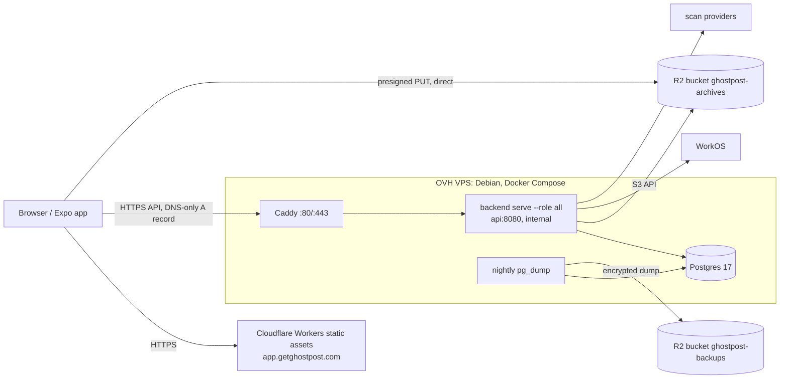

# Deployment plan: OVH VPS backend + Cloudflare frontends

Goal: real users sign in at `app.getghostpost.com`, upload a Reddit or X
archive, get a scan, review flags, and delete their account. One scripted
release smoke proves each step against production. Every piece is a Docker image
or an S3-compatible bucket.

Production backend, worker and PostgreSQL run on one OVH VPS (Debian,
`debian@40.160.254.201`). Caddy terminates TLS for `api.getghostpost.com`. The
VPS bootstrap, scripts, DNS and certificates are in [the VPS runbook](vps.md).

## Scope of the move

Moves to the VPS: the backend (`serve --role all`), PostgreSQL, the nightly
backup job and the TLS reverse proxy.

Explicitly unchanged, on Cloudflare or external:

- The Expo web app at `app.getghostpost.com` and the landing site at
  `getghostpost.com`, both Cloudflare Workers static assets, and the landing D1
  waitlist.
- R2 buckets `ghostpost-archives` (including the `deletion-ledger/v1/` prefix)
  and `ghostpost-backups`.
- WorkOS: redirect URIs and webhook URL keep their current values.

Frontends are not redeployed for this migration.

## Topology

| Piece | Where | Notes |
|---|---|---|
| Expo web | Cloudflare Workers static assets (unchanged) | `EXPO_PUBLIC_API_URL=https://api.getghostpost.com` at build time |
| API + worker | OVH VPS, Docker Compose, same backend image | Internal `api:8080`; reached only through Caddy |
| TLS | Caddy on the VPS, ACME certificates in the persistent `caddy-data` volume | The only service publishing ports: TCP 80 and 443 |
| Postgres 17 | OVH VPS, its own container and volume | Separate migrator (DDL) and `ghostpost_app` (DML) logins; port not published |
| Archive uploads | R2 `ghostpost-archives`, prefix `archive-imports/` | Uploads go straight to R2, so archive bodies never pass through the API host |
| Deletion ledger | Same bucket, prefix `deletion-ledger/v1/` | Protected by an R2 bucket lock retention rule |
| Backups | R2 `ghostpost-backups` | Nightly `pg_dump`, encrypted with `age` before upload |

Everything in R2 stays within the 10 GB free tier, because raw archives expire
after a day.

## Host constraints

The VPS size is not recorded in this repository and is not assumed here. Read
CPU, RAM and disk from the OVH panel and the host (`nproc`, `free -h`,
`df -h /var/lib/docker`) before the first build and keep the numbers in your
notes.

- **Import spool.** The worker streams archives rather than holding them in
  memory: `import.normalize` spools the pinned object to an unlinked temporary
  file under `IMPORT_SPOOL_DIR` (`/var/spool/ghostpost`, the disk-backed
  `import-spool` volume), then streams entries through bounded parsers into
  staging (`backend/src/jobs/archive_import.rs`). Peak memory is independent
  of archive size. Disk is not: `MAX_ARCHIVE_BYTES` is 2 GiB, so budget that
  much spool per concurrent import, plus the staged rows in PostgreSQL.
- **PostgreSQL.** Size disk for the data directory, WAL and a restore. Tune
  memory after measuring real imports; do not guess.
- **Native Rust build.** The release script builds the backend and backup
  images on the VPS. Rust compilation and linking need CPU time, RAM and disk
  for layers and cache. There is no benchmark for this host; record peak RAM,
  duration and disk used during the first `--prepare`, and resize or prune if it
  fails.
- **Ingress.** Only Caddy publishes ports, TCP 80 and 443. Postgres 5432 and
  API 8080 stay unexposed. See [the VPS runbook](vps.md#stack-and-ports).

## Archive uploads on R2 (implemented)

R2 has no presigned POST and no object versioning (Cloudflare's R2 S3
compatibility table lists `GetBucketVersioning`/`PutBucketVersioning` as
unsupported, and presigned URLs only cover GET/PUT/HEAD/DELETE). It does
support atomic conditional writes (`If-None-Match: *` on `PutObject`) and
`If-Match` on reads, which is all the upload contract uses:

1. **Reserve** returns
   `{ id, upload: { method: "PUT", url, headers }, expiresAt }`. The URL is a
   SigV4 presigned PUT (`backend/src/blob/signed_put.rs`) that signs
   `content-length` (the declared size), `content-type`, `host`, and
   `if-none-match: *`. Any other length or type fails the signature, and a
   replayed PUT returns 412.
2. **Complete** runs `HEAD`, checks size and type, and pins the object's ETag
   in `archive_imports.raw_storage_etag` and the `import.normalize` payload.
3. **The worker** reads with `If-Match: <etag>`. Bytes changed after
   completion return 412, which becomes a deterministic `integrity_mismatch`
   rejection; the replaced bytes are purged, never parsed.
4. **Purge** deletes by key and clears `raw_storage_etag`, since a
   single-part ETag is the content's MD5 and must not outlive the bytes.
5. **Deletion ledger** entries are written with `If-None-Match: *`; an
   existing entry is accepted only if byte-identical.

Clients send the returned headers verbatim. The browser uses `fetch(url, {
method: 'PUT', headers, body: file })`. Native uses
`File.upload(url, { httpMethod: 'PUT', uploadType: BINARY_CONTENT, headers })`
from `expo-file-system`, which streams from disk with a fixed
`Content-Length` (`expo/fetch` would buffer the whole file in JS memory and
override `Content-Type` with the file's guessed type).

Proof on the Compose stack (MinIO), artifacts in `backend/target/e2e-artifacts/`:

| Check | Command | Result |
|---|---|---|
| Store contract: short body 403, wrong type 403, exact 200, replay 412; pinned reads fail after an out-of-band overwrite; ledger create-once | `ARCHIVE_S3_INTEGRATION=1 cargo test --locked --test archive_store_s3_contract -- --ignored` (archive env from `backend/.env.example`) | `archive-store-s3-contract.json` |
| Full stack: reserve, PUT, replay 412, complete, worker normalizes, raw purged, anonymous GET denied | `GP_TEST_SESSION=… bash scripts/local-upload-smoke.sh` | `local-upload-smoke.json` |
| Browser CORS: headless Chromium `fetch` PUT from the app origin: 200, replay 412, short 403 | manual probe | `browser-put-probe.json` |

Not yet proven: the same three checks against R2 itself (run the store
contract test with R2 credentials once the bucket exists), and a native
device upload.

## Infrastructure setup (one time)

1. **R2** (already in place for the current production; listed for rebuilds)
   - Bucket `ghostpost-archives`:
     - Lifecycle: delete `archive-imports/` objects after 1 day, and abort
       incomplete multipart uploads after 1 day.
     - Bucket lock on `deletion-ledger/v1/` with retention of 21 days.
     - CORS: origin `https://app.getghostpost.com`, method `PUT`, allowed
       headers `content-type` and `if-none-match`.
   - Bucket `ghostpost-backups`: lifecycle deletes objects after 14 days.
   - Two R2 API tokens, each scoped to one bucket with Object Read & Write: one
     for the backend, one for backups.
2. **Cloudflare** (unchanged by this migration)
   - Worker for the Expo web export on `app.getghostpost.com`. Check that the
     static export's dynamic routes (`review/[id]`) resolve; set the
     `not_found_handling` that makes them work.
   - `api.getghostpost.com` is a DNS-only **A** record to `40.160.254.201`,
     created and changed through the Cloudflare DNS API. The old tunnel record
     is removed at cutover. An AAAA record for `2604:2dc0:301::4:0:1bc` is added
     only after IPv6 reachability and the served certificate are verified from
     outside. See [DNS](vps.md#dns).
3. **VPS**: run `scripts/bootstrap-vps.sh` from your laptop through an
   already-verified key-only SSH session:
   `ssh "$GHOSTPOST_HOST" 'sudo bash -s -- debian' < scripts/bootstrap-vps.sh`.
   It installs Debian's Docker Engine and Compose plugin, `jq` and the other
   base packages, enables unattended security updates, configures `ufw` for TCP
   22/80/443 only, creates `/opt/ghostpost` (mode 0750), and hardens SSH once key
   access is proven. The host-key and `ssh-copy-id` procedure and the full
   description are in [the VPS runbook](vps.md#debian-bootstrap).
   Never share a password in chat or commit it.
4. **Postgres**: PostgreSQL's init script creates the migrator and
   `ghostpost_app` logins when `--prepare` first starts an empty database. Run
   `scripts/smoke-postgres-gate.sh` against a migrated test database as
   before; it is not a production gate.
5. **WorkOS production environment** (unchanged)
   - Authentication → Methods: enable **Magic Auth** for six-digit email-code
     sign-in. Enterprise SSO alone cannot authenticate personal email accounts.
   - Authentication → Features: keep **Sign-up** enabled so first-time users
     can create an account.
   - Branding → Display name: **Ghostpost**. Without this override, authentication
     emails use the WorkOS team name. WorkOS currently sends them from
     `no-reply@workos-mail.com`.
   - Redirect URIs: `https://app.getghostpost.com/auth/callback` and
     `ghostpost://auth/callback`.
   - Webhook: `https://api.getghostpost.com/v1/webhooks/workos`.
6. **Secrets**: the source of truth is `~/.config/ghostpost/production.env` on
   your laptop (mode 600). The deploy scripts ship only the allowlisted keys in
   `.env.production.example` to `/opt/ghostpost/.env.production` (mode 600,
   gitignored). `CLOUDFLARE_TUNNEL_TOKEN` is no longer shipped.
   - Database: `POSTGRES_SUPERUSER_PASSWORD`, `POSTGRES_MIGRATOR_PASSWORD`,
     `POSTGRES_APP_PASSWORD`.
   - WorkOS: `WORKOS_*`, `APP_SESSION_KEYS`.
   - Scan provider: `SCAN_LLM_PROVIDER=jev`, `TYPESAFE_API_KEY`.
     Use `DEEPSEEK_API_KEY` instead for `SCAN_LLM_PROVIDER=deepseek-flash`.
     No approval manifest is required.
   - Keys: `ARCHIVE_FINGERPRINT_KEYS`, `SCAN_BATCH_HMAC_KEYS`.
   - Storage: the R2 account id and tokens (`R2_*`), consumed by the compose
     file as `ARCHIVE_BUCKET=ghostpost-archives`, `ARCHIVE_S3_REGION=auto`, the
     account's `r2.cloudflarestorage.com` endpoint and path-style addressing.
     Uploads are signed for the same endpoint, so browsers PUT straight to R2.
   - **Keep every encryption, session, fingerprint and HMAC key and the
     database role passwords identical to the previous production.** See
     [Cutover requirements](#cutover-requirements).
   - Keep an `age`-encrypted copy in your password manager.

## Production Compose

`docker-compose.prod.yml` (project `ghostpost`) differs from
`docker-compose.yml`:

- No MinIO. Storage is R2.
- Postgres gets no published port.
- A `migrate` one-shot service runs the same image with
  `command: ["migrate"]` and only the DDL env.
- `api` runs `serve --role all`, listens on internal `api:8080`, and
  `depends_on: migrate` with `condition: service_completed_successfully`.
- `caddy` publishes TCP 80 and 443 only, mounts `docker/Caddyfile` and the
  persistent `/data` and `/config` volumes, and proxies `api.getghostpost.com`
  to `api:8080`. Nothing else publishes ports.
- `backup` runs nightly: `pg_dump | age -r <pubkey>`, uploaded to
  `s3://ghostpost-backups/...`.
- `restart: unless-stopped` everywhere except `migrate`. JSON logs go to the
  local Docker driver with rotation.

## Release procedure

Releases deploy an immutable Git SHA with `scripts/deploy-vps.sh`, run from your
laptop against `GHOSTPOST_HOST` (default `debian@40.160.254.201`), with
`GHOSTPOST_ENV_FILE` defaulting to `~/.config/ghostpost/production.env`. The
remote root is `/opt/ghostpost`. `scripts/deploy-htpc.sh` is gone; there is no
compatibility wrapper.

Interfaces (details in [the VPS runbook](vps.md#scripts-and-interfaces)):

| Command | Does | Never does |
|---|---|---|
| `bash scripts/deploy-vps.sh --prepare <sha>` | Ships the release and allowlisted secrets, builds the backend and backup images, starts PostgreSQL until healthy | Application migrations, API, workers, Caddy, backups, DNS, any claim of being live |
| `bash scripts/restore-production.sh --release <sha> --backup <age dump> --restore-point <RFC3339> [--identity <age key>]` | Decrypts locally, streams into the fresh database, runs the release's migrations, seeds the restore guard, runs `deletion replay`, then atomically writes `/opt/ghostpost/.database-restored` (`{release, restorePoint, restoredAt}`, no secrets) | Copies the key or plaintext to the server, restores into a non-empty database or while the API, worker or Caddy runs, has reset/drop/force flags |
| `bash scripts/deploy-vps.sh <sha>` | Builds, takes the deploy lock, migrates, starts `api` (waits for internal readiness), then `caddy` and `backup`; smokes the requested public API; only after the smoke passes, updates `/opt/ghostpost/current` and `deploys.jsonl` | Runs on a fresh target before `.database-restored` exists; silently skips public verification; marks a release current before the smoke passes; rolls back automatically |
| `bash scripts/deploy-vps.sh --rollback <sha>` | Restarts a retained release that was deployed successfully before, if the database has every migration it contains; same public smoke before marking it current | Runs migrations, downgrades the database, overwrites secrets or data, switches back to the stale source host, or proves an older binary works on the newer schema |

Order for a cutover: bootstrap, `--prepare`, restore, DNS record, normal deploy,
then the [verification](#verification-after-cutover).

The default production smoke must verify more than a healthy response: the
public connection's peer IP has to be one of the target VPS's global IPs. A
healthy old API still answering at the name must not pass for the new release.
Overriding `GHOSTPOST_API_URL` is only for deliberate isolated verification and
is recorded in the deploy log.

Migrations are not guaranteed to be expand-only. Rollback never downgrades the
database and only accepts a known retained release whose migrations are all
already applied; whether that older binary works with the newer schema and data
is the operator's responsibility.

**The released commit is separate from unrelated work.** The VPS deploys a
selected committed SHA (via `git archive`, not the working tree). The current
production release is an infrastructure-only commit; the uncommitted onboarding,
classifier and lint work in the working tree is not part of it, and `--worktree`
snapshots are not a way to ship it. Deploy that work later as its own reviewed
release.

The frontends are not part of this release. When app code does change, deploy
the web app separately with `npm --prefix app run deploy:web`, which exports
Expo, prepares dynamic-route assets and the 404 page, and deploys to Cloudflare.

## Cutover requirements

- **Prefer a fresh final dump.** Stop the old API and worker from accepting
  writes, dump the source database, encrypt it with the production
  `BACKUP_AGE_RECIPIENT`, and restore that with the current release. This
  loses no data.
- **A stale backup needs explicit acceptance.** If the source is unreachable,
  restore the newest R2 backup. The newest found so far is
  `postgres/2026/11/11/20261111T100246Z.dump.age` (264,453 bytes, 2026-11-11
  10:02 UTC); everything written after it is lost. Having the restore script
  does not authorise using it. Accept the loss first.
- **Restore point is the dump's start, not its end.** `--restore-point` must be
  at or before the moment the dump's transaction snapshot began: for a final
  dump, record a timestamp just before starting `pg_dump`; for an R2 backup, use
  the timestamp in its filename (taken just before `pg_dump` starts). Never use
  the dump's end time: a deletion made during the dump may be missing from the
  snapshot, and replay from a later point would skip its ledger marker.
- **Deletion replay before traffic.** `restore-production.sh` runs
  `deletion replay` from `--restore-point` against the preserved R2 ledger
  before any API or worker starts. The 21-day ledger retention outlasts the
  14-day backups, so a restored dump does not resurrect accounts deleted since
  it was taken.
- **Same cryptographic keys.** Reuse the old `ARCHIVE_FINGERPRINT_KEYS`,
  `SCAN_BATCH_HMAC_KEYS`, `APP_SESSION_KEYS`, `WORKOS_COOKIE_PASSWORD`, database
  role passwords and backup age recipient. Different keys break restored
  fingerprints and batches, invalidate sessions, and make new backups
  undecryptable with the old private key.
- **One active writer.** Never run an API or worker against the old and new
  databases at the same time.
- **Stop the old backup scheduler at cutover**, so only the VPS writes new
  backups to `ghostpost-backups`.
- **Rollback after new writes is not a DNS revert.** Once the VPS has accepted a
  write, pointing the name back at the old database discards those writes and
  can resurrect deleted accounts. A stale source database is never a rollback
  target after writes. Fix forward, or dump the VPS and restore that into
  whichever host should be active with the other stopped.

## Verification after cutover

None of this has been run against the VPS yet. Do not mark the migration done
from a green deploy alone: the deploy script's own smoke is a minimal public
API check (health, WorkOS authorize, and the peer-IP check above), not these
journeys. A restore rehearsal into a throwaway target has also not been done;
do it before relying on the new backups.

1. **Health.** `scripts/smoke-health.sh https://api.getghostpost.com` and
   `scripts/smoke-workos-authorize.sh https://api.getghostpost.com`, plus a
   valid certificate from Caddy.
2. **WorkOS journey.** Real sign-up, sign-in, logout and account deletion at
   `app.getghostpost.com` against the VPS API (the `app/e2e/auth.spec.ts`
   suite, below).
3. **Archive flow.** A real Reddit export and a real X export through the R2 PUT
   flow, each reaching `ready`; a scan reaching `succeeded` with flags; a review
   action on a flag; and purge: after account deletion its rows and sessions are
   gone, its R2 keys are gone, and a ledger marker plus the provider-complete
   companion exist.
4. **Encrypted backup.** After the first scheduled run (or a manual `once`), a
   new `postgres/YYYY/MM/DD/*.dump.age` object exists in R2, is non-empty, and
   decrypts locally with `~/.config/ghostpost/backup-age.key`.

## Release smoke (first launch, then every release)

Against production, with a dedicated test account:

1. Web sign-in through WorkOS.
2. Upload a real Reddit export and a real X export through the R2 PUT flow.
   Each import reaches `ready`.
3. Start a scan. It reaches `succeeded` and returns flags.
4. Run a review action on a flag.
5. Delete the account. Its rows and sessions are gone, its R2 keys are gone,
   and a ledger marker plus the provider-complete companion exist.

Use an account that completed a scan and review, not just an empty account.
Account purge deletes owned scans first so their scan/archive links cascade
before imports are removed; another account's scans must remain untouched.
The populated-account regression is in `backend/tests/account_purge_archive_contracts.rs`
and runs with `cargo test --locked --test account_purge_archive_contracts -- --ignored`
against a migrated test Postgres database.

Save a report containing status codes, IDs and timings (no archive content)
as `smoke-reports/<sha>.json` on the VPS.

Authentication browser regression coverage is also available in
`app/e2e/auth.spec.ts`; see [the app E2E instructions](../app/README.md#authentication-browser-e2e).
It drives real WorkOS sign-up/sign-in, logout, and account deletion against the
deployed app in Chromium and mobile WebKit. Run `npm run test:e2e` from `app/`
with `E2E_BASE_URL` and `E2E_WORKOS_API_KEY` loaded from your secret store.
The HTML report, journey evidence, screenshots, and videos are retained in
`app/e2e/artifacts/`; failed runs also retain traces.

The `app-auth-e2e` GitHub workflow runs daily and manually. It also runs when a
successful GitHub production deployment event names `APP_E2E_BASE_URL` as its
environment URL; a direct Wrangler/SSH deployment does not emit that event.
Repository secret `WORKOS_E2E_API_KEY` contains the dedicated `ghostpost-e2e`
WorkOS key. This is deployed-release verification, not a pre-deployment gate.
It does not replace the archive/scan/review/storage smoke above or physical
iPhone/Home Screen verification.

## Backups and restore

- RPO is 24 hours (nightly dumps), and backups are kept 14 days.
- Ledger retention (21 days) is longer than backup retention plus 7 days. A
  restored dump can't bring back an account deleted after it was taken,
  because the backend's existing `deletion replay` command
  (`RESTORE_DATABASE_URL`, `RESTORE_GUARD_TOKEN`, `RESTORE_POINT`, with
  `RESTORE_REPLAY_PENDING=true`) replays newer ledger markers first.
- `scripts/restore-production.sh` performs the restore procedure for the VPS:
  1. Decrypt locally and stream into a fresh database (`pg_restore
     --single-transaction --exit-on-error`, so it commits entirely or not at
     all), owned by the migrator role, with refreshed `ghostpost_app` grants.
  2. Run the selected release's migrations.
  3. Seed the restore guard (`backend/migrations/20260727000015_restore_guard.sql`).
  4. Run `deletion replay` (with `RESTORE_REPLAY_PENDING=true`) before any API
     or worker starts.
  5. Write `.database-restored`; only then may `scripts/deploy-vps.sh <sha>`
     start production.
- If migration or replay fails after the restore committed, the tool keeps
  `/opt/ghostpost/.restore-state` (release, restore point, backup SHA-256,
  stage). Re-run the identical command to resume at migrate/replay; a
  different backup, release or restore point is refused. Do not delete the
  database to retry.
- Rehearse once before relying on it, with a throwaway account that was deleted
  after the dump was taken. This has not been done for the VPS.

## Launch blockers outside infrastructure

- **Privacy copy.** The landing FAQ claims archives are processed in an
  isolated environment and lists Instagram, TikTok and Facebook. The VPS and
  its isolation claim need to be described accurately, and the platform list
  must match what ships (Reddit and X).

## Rollback

| Failure | Action |
|---|---|
| Migration fails | The API isn't restarted. Fix forward with a new migration. |
| API unhealthy after deploy | `scripts/deploy-vps.sh --rollback <previous-sha>`, only for a retained release that was deployed successfully and whose migrations are all applied. Rollback never downgrades the schema, and compatibility of the older binary with the newer schema is the operator's responsibility; otherwise fix forward. |
| VPS down | The API is unavailable (clients see errors) until it returns; the durable queue resumes on boot. Do not fail over to the stale old database. |
| Leaked secret | Rotate it in the production env file, redeploy, then confirm `api` restarts. Rotating an encryption/session/fingerprint/HMAC key is a data decision; follow its own key-versioning rules rather than replacing it. |
| Data loss or corruption | Follow the restore procedure above, on a fresh target, with the stale-backup acceptance rule. |
| Bad cutover before any write | Re-point DNS only if the old database was untouched and the VPS has accepted no writes. After any write, see [Cutover requirements](#cutover-requirements). |

## Legacy HTPC source

The HTPC libvirt VM (`ghostpost`) was the previous production origin behind
`cloudflared`. It stays only as a data source to recover from; its provisioning
files under `scripts/htpc/` are legacy tools, not a bootstrap path for the VPS.
Recovery facts are in the [legacy appendix](vps.md#appendix-legacy-htpc-source-recovery).
Today the laptop route to it fails with "No route to host", so a fresh final
dump may not be obtainable.
