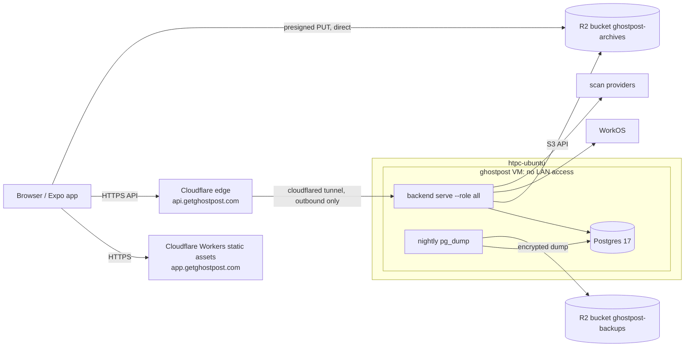

# Deployment plan: HTPC + Cloudflare free tier

Goal: real users sign in at `app.getghostpost.com`, upload a Reddit or X
archive, get a scan, review flags, and delete their account. One scripted
release smoke proves each step against production. Recurring cost is about $0
plus model usage. Every piece is a Docker image or an S3-compatible bucket, so
moving to a cloud later is a configuration change.

## Topology

| Piece | Where | Notes |
|---|---|---|
| Expo web | Cloudflare Workers static assets, same setup as `landing/` | `EXPO_PUBLIC_API_URL=https://api.getghostpost.com` at build time |
| API + worker | HTPC VM, Docker Compose, same backend image | Reachable only through `cloudflared`. No inbound ports. |
| Postgres 17 | HTPC VM, its own container and volume | Separate migrator (DDL) and `ghostpost_app` (DML) logins, as now |
| Archive uploads | R2 `ghostpost-archives`, prefix `archive-imports/` | Uploads go straight to R2, bypassing the tunnel's 100 MB body limit |
| Deletion ledger | Same bucket, prefix `deletion-ledger/v1/` | Protected by an R2 bucket lock retention rule |
| Backups | R2 `ghostpost-backups` | Nightly `pg_dump`, encrypted with `age` before upload |

Everything in R2 stays within the 10 GB free tier, because raw archives expire
after a day.

## Host constraints

Measured on 2026-10-15 (`htpc-ubuntu`):

- i7-8565U, 8 threads, 15 GiB RAM, 75 GB free on `/` (84% used).
- **WiFi only** (`wlp0s20f3`). Expect brief outages. The durable work queue
  retries, so an outage delays imports and scans but doesn't lose them.
- Shares the host with Immich (personal photos), Plex, qBittorrent-VPN, the
  *arr suite, and the autohired and greenkeep stacks.

### Isolation (required before real user data)

Run Ghostpost inside a dedicated libvirt VM (`virbr0` exists) with Ubuntu
24.04, 4 vCPU, 6 GiB RAM and a 40 GB disk. Docker, `cloudflared` and Tailscale
run inside the VM.

- A host firewall rule drops VM traffic to `192.168.4.0/22` and to the host's
  Docker bridges. The VM can reach only the internet and the tailnet.
- Admin access is SSH over Tailscale only.
- No host bind mounts. Postgres data lives on a named volume inside the VM.

**Memory risk:** the import worker reads the whole pinned archive into memory
(`read_pinned` in `backend/src/jobs/archive_import.rs` allocates `byte_size`
bytes), and `ARCHIVE_MAX_BYTES` is 2 GiB. Two concurrent maximum-size imports
would exhaust the VM. Either cap imports at one at a time or lower
`ARCHIVE_MAX_BYTES` until the importer streams. Decide before launch.

## Archive uploads on R2 (implemented)

R2 has no presigned POST and no object versioning (Cloudflare's R2 S3
compatibility table lists `GetBucketVersioning`/`PutBucketVersioning` as
unsupported, and presigned URLs only cover GET/PUT/HEAD/DELETE). It does
support atomic conditional writes (`If-None-Match: *` on `PutObject`) and
`If-Match` on reads, which is all the upload contract uses:

1. **Reserve** returns
   `{ id, upload: { method: "PUT", url, headers }, expiresAt }`. The URL is a
   SigV4 presigned PUT (`backend/src/blob/signed_put.rs`) that signs
   `content-length` (the declared size), `content-type`, `host`, and
   `if-none-match: *`. Any other length or type fails the signature, and a
   replayed PUT returns 412.
2. **Complete** runs `HEAD`, checks size and type, and pins the object's ETag
   in `archive_imports.raw_storage_etag` and the `import.normalize` payload.
3. **The worker** reads with `If-Match: <etag>`. Bytes changed after
   completion return 412, which becomes a deterministic `integrity_mismatch`
   rejection; the replaced bytes are purged, never parsed.
4. **Purge** deletes by key and clears `raw_storage_etag`, since a
   single-part ETag is the content's MD5 and must not outlive the bytes.
5. **Deletion ledger** entries are written with `If-None-Match: *`; an
   existing entry is accepted only if byte-identical.

Clients send the returned headers verbatim. The browser uses `fetch(url, {
method: 'PUT', headers, body: file })`. Native uses
`File.upload(url, { httpMethod: 'PUT', uploadType: BINARY_CONTENT, headers })`
from `expo-file-system`, which streams from disk with a fixed
`Content-Length` (`expo/fetch` would buffer the whole file in JS memory and
override `Content-Type` with the file's guessed type).

Proof on the Compose stack (MinIO), artifacts in `backend/target/e2e-artifacts/`:

| Check | Command | Result |
|---|---|---|
| Store contract: short body 403, wrong type 403, exact 200, replay 412; pinned reads fail after an out-of-band overwrite; ledger create-once | `ARCHIVE_S3_INTEGRATION=1 cargo test --locked --test archive_store_s3_contract -- --ignored` (archive env from `backend/.env.example`) | `archive-store-s3-contract.json` |
| Full stack: reserve, PUT, replay 412, complete, worker normalizes, raw purged, anonymous GET denied | `GP_TEST_SESSION=… bash scripts/local-upload-smoke.sh` | `local-upload-smoke.json` |
| Browser CORS: headless Chromium `fetch` PUT from the app origin: 200, replay 412, short 403 | manual probe | `browser-put-probe.json` |

Not yet proven: the same three checks against R2 itself (run the store
contract test with R2 credentials once the bucket exists), and a native
device upload.

## Infrastructure setup (one time)

1. **R2**
   - Bucket `ghostpost-archives`:
     - Lifecycle: delete `archive-imports/` objects after 1 day, and abort
       incomplete multipart uploads after 1 day.
     - Bucket lock on `deletion-ledger/v1/` with retention of 21 days.
     - CORS: origin `https://app.getghostpost.com`, method `PUT`, allowed
       headers `content-type` and `if-none-match`.
   - Bucket `ghostpost-backups`: lifecycle deletes objects after 14 days.
   - Two R2 API tokens, each scoped to one bucket with Object Read & Write: one
     for the backend, one for backups.
2. **Cloudflare**
   - Tunnel `ghostpost` with ingress `api.getghostpost.com → http://api:8080`.
   - Worker for the Expo web export on `app.getghostpost.com`. Check that the
     static export's dynamic routes (`review/[id]`) resolve; set the
     `not_found_handling` that makes them work.
3. **VM**: create as described above. Install Docker, Tailscale and
   `cloudflared`. Clone the repo into `/opt/ghostpost`.
4. **Postgres**: create the migrator and `ghostpost_app` logins, then run
   `scripts/smoke-postgres-gate.sh`.
5. **WorkOS production environment**
   - Authentication → Methods: enable **Magic Auth** for six-digit email-code
     sign-in. Enterprise SSO alone cannot authenticate personal email accounts.
   - Authentication → Features: keep **Sign-up** enabled so first-time users
     can create an account.
   - Branding → Display name: **Ghostpost**. Without this override, authentication
     emails use the WorkOS team name. WorkOS currently sends them from
     `no-reply@workos-mail.com`.
   - Redirect URIs: `https://app.getghostpost.com/auth/callback` and
     `ghostpost://auth/callback`.
   - Webhook: `https://api.getghostpost.com/v1/webhooks/workos`.
6. **Secrets**: keep them in `/opt/ghostpost/.env.production` (mode 600,
   gitignored, inside the VM only).
   - Database: `DATABASE_URL`, `DATABASE_URL_APP`, `DATABASE_APP_ROLE`.
   - WorkOS: `WORKOS_*`, `APP_SESSION_KEYS`.
   - Scan provider: `SCAN_LLM_PROVIDER=jev`, `TYPESAFE_API_KEY`.
     Use `DEEPSEEK_API_KEY` instead for `SCAN_LLM_PROVIDER=deepseek-flash`.
     No approval manifest is required.
   - Keys: `ARCHIVE_FINGERPRINT_KEYS`, `SCAN_BATCH_HMAC_KEYS`.
   - Storage: `ARCHIVE_BUCKET=ghostpost-archives`, `ARCHIVE_S3_REGION=auto`,
     `ARCHIVE_S3_ENDPOINT=https://<account>.r2.cloudflarestorage.com`,
     `ARCHIVE_S3_FORCE_PATH_STYLE=true`, and the R2 token as
     `AWS_ACCESS_KEY_ID`/`AWS_SECRET_ACCESS_KEY`. Uploads are signed for the
     same endpoint, so browsers PUT straight to R2.
   - Keep an `age`-encrypted copy in your password manager.

## Production Compose

Add `docker-compose.prod.yml`, based on `docker-compose.yml`, with these
differences:

- No MinIO. Storage is R2.
- Postgres gets no published port.
- A `migrate` one-shot service runs the same image with
  `command: ["migrate"]` and only the DDL env.
- `api` runs `serve --role all` and `depends_on: migrate` with
  `condition: service_completed_successfully`.
- `cloudflared` runs with the tunnel token.
- `backup` runs nightly: `pg_dump | age -r <pubkey> | aws s3 cp - s3://ghostpost-backups/...`.
- `restart: unless-stopped` everywhere except `migrate`. JSON logs go to the
  local Docker driver with rotation.

## Release procedure

`scripts/deploy-htpc.sh <git-sha>`, run from a laptop on the tailnet. CI uses
the same script later through `tailscale/github-action`.

1. Snapshot and ship the selected Git SHA to `/opt/ghostpost/releases/<sha>`.
   Use `bash scripts/deploy-htpc.sh --worktree` to deploy uncommitted work
   without changing Git refs. Secrets come from the allowlisted keys in
   `~/.config/ghostpost/production.env`.
2. Build the backend and backup images natively on the VM.
3. Start Postgres and run `docker compose ... run --rm --interactive=false migrate`.
   Disabling stdin is required: otherwise Compose can consume the remaining
   SSH-fed deploy script and exit before starting the API. Abort on migration failure.
4. Wait for a healthy API, start `cloudflared` and nightly backups, and update
   `/opt/ghostpost/current`.
5. Run the public health and WorkOS authorization smoke scripts.
6. Deploy the web app with `npm --prefix app run deploy:web`, which exports
   Expo, prepares dynamic-route assets and the 404 page, and deploys to Cloudflare.

A lock file at `/opt/ghostpost/.deploy.lock` inside the VM prevents two
concurrent deploys.

## Release smoke (first launch, then every release)

Against production, with a dedicated test account:

1. Web sign-in through WorkOS.
2. Upload a real Reddit export and a real X export through the R2 PUT flow.
   Each import reaches `ready`.
3. Start a scan. It reaches `succeeded` and returns flags.
4. Run a review action on a flag.
5. Delete the account. Its rows and sessions are gone, its R2 keys are gone,
   and a ledger marker plus the provider-complete companion exist.

Save a report containing status codes, IDs and timings (no archive content)
as `smoke-reports/<sha>.json` in the VM.

Authentication browser regression coverage is also available in
`app/e2e/auth.spec.ts`; see [the app E2E instructions](../app/README.md#authentication-browser-e2e).
It drives real WorkOS sign-up/sign-in, logout, and account deletion against the
deployed app in Chromium and mobile WebKit. Run `npm run test:e2e` from `app/`
with `E2E_BASE_URL` and `E2E_WORKOS_API_KEY` loaded from your secret store.
The HTML report, journey evidence, screenshots, and videos are retained in
`app/e2e/artifacts/`; failed runs also retain traces.

The `app-auth-e2e` GitHub workflow runs daily and manually. It also runs when a
successful GitHub production deployment event names `APP_E2E_BASE_URL` as its
environment URL; a direct Wrangler/SSH deployment does not emit that event.
Repository secret `WORKOS_E2E_API_KEY` contains the dedicated `ghostpost-e2e`
WorkOS key. This is deployed-release verification, not a pre-deployment gate.
It does not replace the archive/scan/review/storage smoke above or physical
iPhone/Home Screen verification.

## Backups and restore

- RPO is 24 hours (nightly dumps), and backups are kept 14 days.
- Ledger retention (21 days) is longer than backup retention plus 7 days. A
  restored dump can't bring back an account deleted after it was taken,
  because the backend's existing `deletion replay` command
  (`RESTORE_DATABASE_URL`, `RESTORE_GUARD_TOKEN`, `RESTORE_POINT`) replays
  newer ledger markers first.
- Restore procedure:
  1. Restore into a fresh database.
  2. Seed the restore guard (`backend/migrations/20260727000015_restore_guard.sql`).
  3. Run `deletion replay` with `RESTORE_REPLAY_PENDING=true`. Readiness stays
     503.
  4. Switch `DATABASE_URL*` and restart the API with
     `RESTORE_REPLAY_PENDING=false`.
- Rehearse once before launch with a throwaway account that was deleted after
  the dump was taken.

## Launch blockers outside infrastructure

- **Privacy copy.** The landing FAQ claims archives are processed in an
  isolated environment and lists Instagram, TikTok and Facebook. The VM covers
  the first claim; the platform list must match what ships (Reddit and X).

## Rollback

| Failure | Action |
|---|---|
| Migration fails | The API isn't restarted. Fix forward with a new migration. |
| API unhealthy after deploy | `scripts/deploy-htpc.sh <previous-sha>`. Migrations are expand-only, so the old binary runs on the new schema. |
| Host down | Cloudflare returns 502 and the queue resumes on boot. Nothing else is needed. |
| Leaked secret | Rotate it in `.env.production`, then run `docker compose up -d api`. |
| Data loss or corruption | Follow the restore procedure above. |

## When to leave the HTPC

Move when any of these happen: paying users need uptime the WiFi can't give,
imports or scans queue behind host load, or the VM needs more than about half
the host's RAM. The image, Compose file and R2 bucket move as-is to
Fly/Hetzner/ECS; only the Postgres host and the tunnel change.
